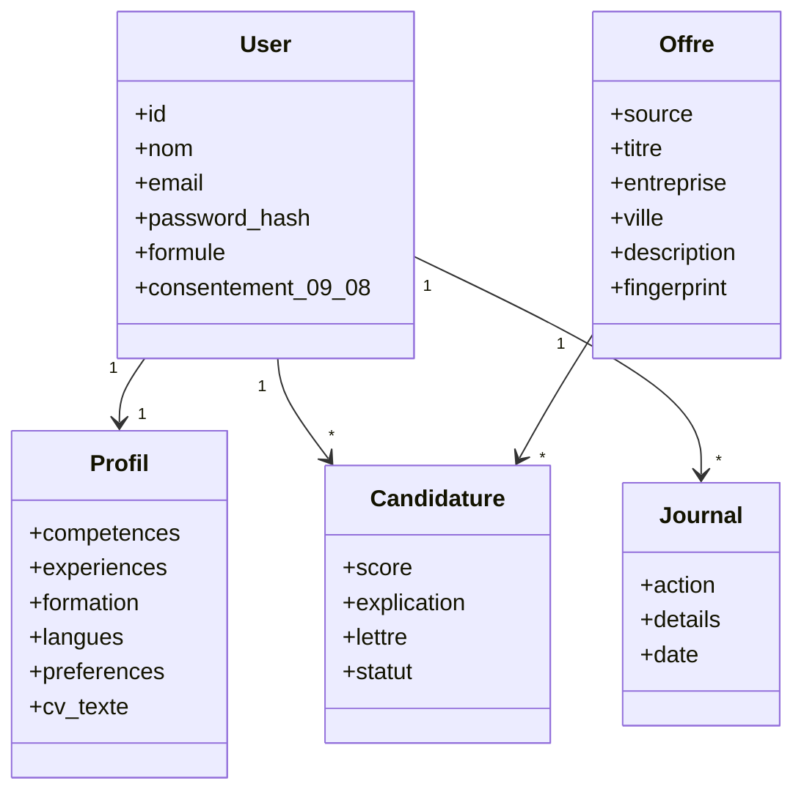
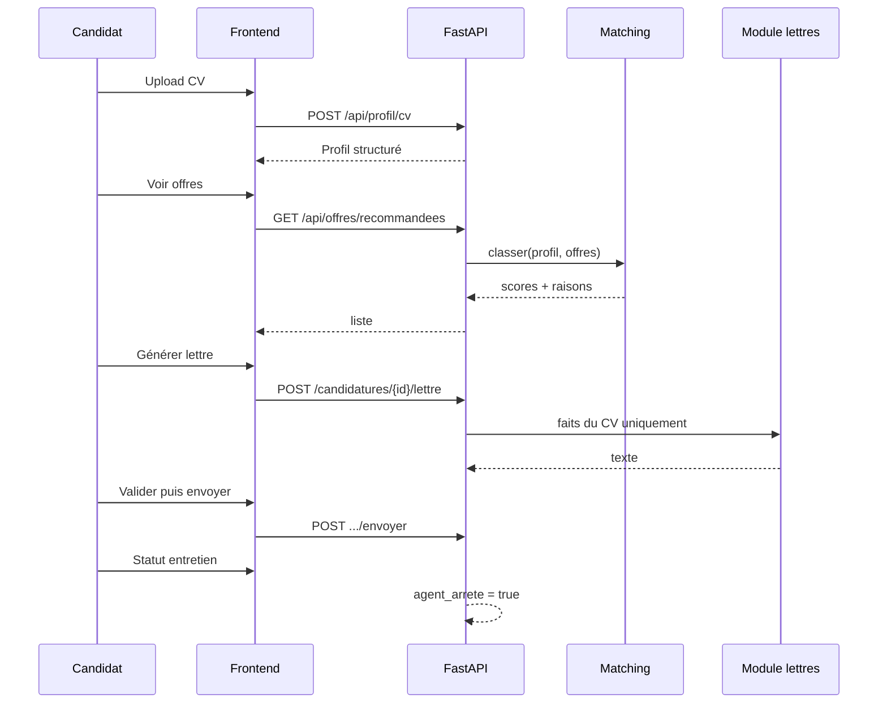

# Diagrammes UML

## Cas d'utilisation

```mermaid
usecaseDiagram
    actor Candidat
    actor Agent
    Candidat --> (Créer un compte et consentir 09-08)
    Candidat --> (Importer un CV)
    Candidat --> (Consulter les offres scorées)
    Candidat --> (Valider une lettre)
    Candidat --> (Suivre les statuts)
    Candidat --> (Choisir une formule)
    Candidat --> (Supprimer ses données)
    Agent --> (Collecter les offres)
    Agent --> (Calculer le matching)
    Agent --> (Générer une lettre honnête)
    Agent --> (Journaliser)
    Agent --> (Arrêter après un entretien)
    (Valider une lettre) ..> (Générer une lettre honnête) : include
    (Suivre les statuts) ..> (Arrêter après un entretien) : extend
```

## Classes (simplifié)



## Séquence — du CV à l'entretien


